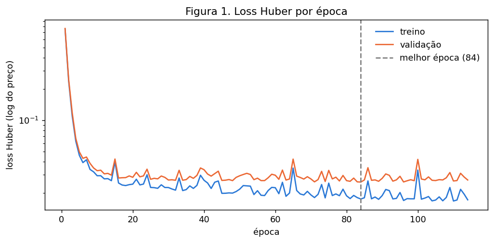
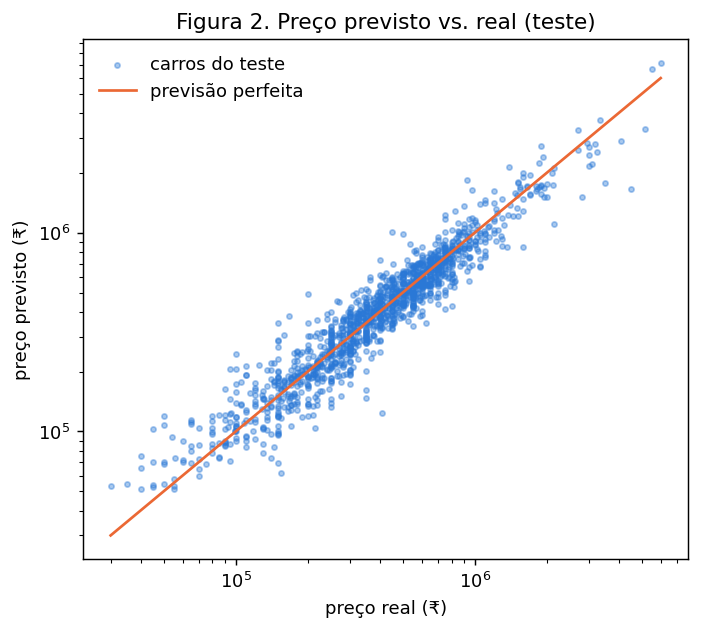
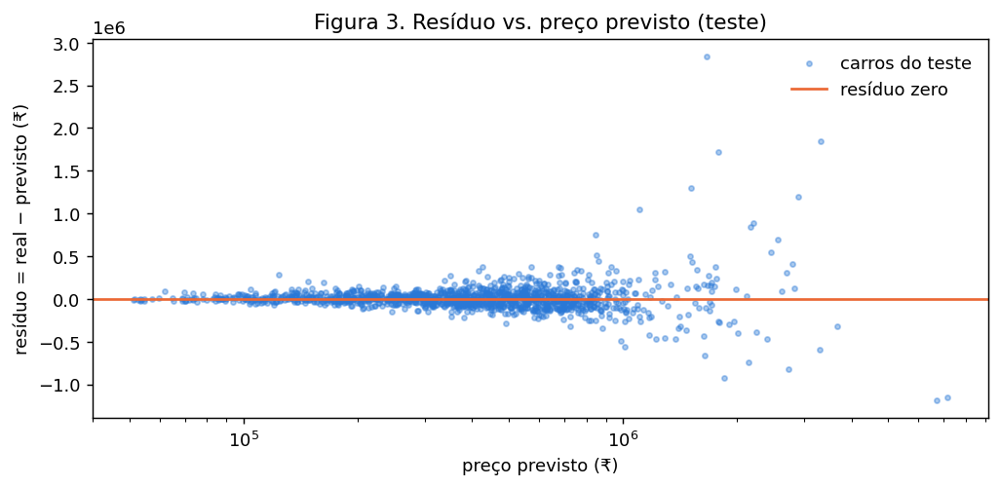
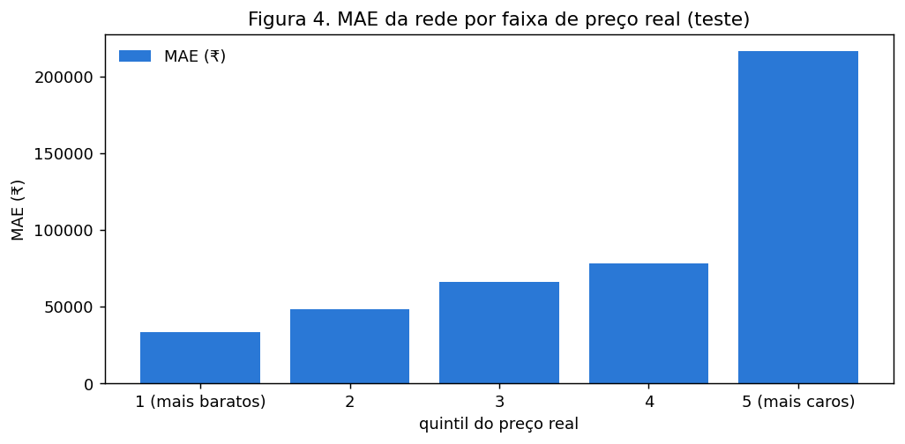

# 2. Regressão

!!! abstract "Entrega 2 de 3 do [Projeto](../index.md)"

    [Projects](https://insper.github.io/ann-dl/){:target='_blank'}

!!! info "Equipe"

    | Nome completo | GitHub |
    |---------------|--------|
    | Cynthia Naoko Yasutake | CYNahko|
    | Davi Peter Bastian Nehls | dpnnpd |
    | Henrique Bromfman de Puppi e Silva | kikepuppi |

!!! tip "Como reproduzir"

    Todos os números e figuras desta página saem de `code/regression.py`, com `random_state=42` em tudo:

    ```bash
    python -m venv .venv
    pip install -r requirements.txt
    python docs/projects/regression/code/regression.py
    ```

Prevemos o preço de revenda de carros usados (`selling_price`, em ₹) a partir do
`Car details v3.csv`, o mesmo dataset e alvo da [EDA](../eda/index.md).

## 0. Ponto de partida

Reusamos o pipeline da EDA sem mudanças (`eda/code/preprocessing.py`): a mesma limpeza, o mesmo
split 80/20 estratificado por decis de `log(preço)` e o mesmo `random_state=42`. A validação sai do
treino, com outro split 80/20 estratificado da mesma forma. O pipeline é ajustado só nas linhas de
treino e depois aplicado à validação e ao teste. Não recebemos feedback da EDA para corrigir.

| Conjunto | Linhas |
|----------|--------|
| Treino | 4.420 |
| Validação | 1.105 |
| Teste | 1.382 |

Depois do pipeline, cada carro vira um vetor de 40 features.

**Métrica principal:** MAE em ₹, na escala original do preço. É o erro médio em rúpias, fácil de
ler para quem compra ou vende.

**Critério de sucesso**, fixado antes de treinar: a rede precisa ter MAE no teste pelo menos 15%
menor que o do melhor baseline.

## 1. Baselines

Treinamos dois modelos simples sobre o `log(preço)` e avaliamos na validação, depois de voltar à
escala em ₹ com `exp`:

- **Dummy (mediana):** prevê sempre a mediana do treino. É o piso: qualquer modelo útil tem que
  ficar abaixo dele.
- **Ridge:** regressão linear com regularização L2 (`alpha=1`).

| Modelo | MAE (₹) | RMSE (₹) | R² |
|--------|--------:|---------:|---:|
| Dummy (mediana) | 278.744 | 523.161 | −0,054 |
| Ridge | 92.824 | 192.640 | 0,857 |

O Ridge é o melhor baseline. Erra em média ₹92.824, um terço do erro da mediana, e explica 85,7%
da variância do preço. Pelo critério de sucesso, a rede precisa ficar pelo menos 15% abaixo do MAE
do Ridge no teste.

## 2. A rede

A rede é um MLP (*multilayer perceptron*) em PyTorch, montado pela função `criar_rede` em
`code/regression.py`:

```
entrada (40) → Linear(40, 64) → ReLU → Linear(64, 32) → ReLU → Linear(32, 1) → log(preço)
```

| Escolha | Valor | Por quê |
|---------|-------|---------|
| Entrada | 40 neurônios | Uma por feature que sai do pipeline da EDA |
| Camadas escondidas | 2, com 64 e 32 neurônios | Cada camada combina as features da anterior. Duas já captam interações como combustível × ano × câmbio, que o Ridge não vê. A largura começa um pouco acima da entrada e afunila até a saída |
| Ativação | ReLU, `max(0, x)` | Sem ela, as camadas se juntariam numa única transformação linear e a rede seria só outra regressão linear. A ReLU é o padrão em MLP e não satura para valores positivos |
| Inicialização | He (`kaiming_normal_`), bias zero | Sorteia os pesos com variância 2/entradas, a escala certa para a ReLU: o sinal não some nem explode ao passar pelas camadas |
| Saída | 1 neurônio linear, sem ativação | A tarefa é regressão. A saída é o `log(preço)`, que pode ser qualquer número real |
| Loss | Huber com `delta=0.5` | Explicação abaixo |

**Parâmetros contra linhas de treino.** A rede tem 4.737 parâmetros (pesos e bias) e o treino tem
4.420 linhas, cerca de 1,07 parâmetro por linha. Com essa proporção a rede tem capacidade de sobra
para decorar o treino, então o controle de overfitting fica com o early stopping (seção 3) e com
a regularização (seção 4). Uma rede bem maior teria muito mais parâmetros que dados.

**Loss.** Treinamos no `log(preço)`, como na EDA, porque o preço bruto tem assimetria de 5,57 e um
erro de ₹100 mil pesa diferente num carro de ₹3 lakh e num de ₹50 lakh. No log, o erro passa a ser
relativo. Mesmo assim sobram outliers: nos resíduos do Ridge no treino, a mediana do erro absoluto
é 0,15, o percentil 95 é 0,49 e o máximo é 2,25, ou seja, um carro com o preço errado por um fator
de 9. Com MSE, esses poucos casos dominariam o gradiente. A Huber é quadrática para erros até
`delta` e linear acima dele. Com `delta=0.5`, só 4,7% das linhas caem na parte linear: o resto é
tratado como no MSE e os outliers perdem peso.

## 3. Treino

O treino fica na função `treinar` em `code/regression.py`.

| Escolha | Valor | Por quê |
|---------|-------|---------|
| Otimizador | Adam | Ajusta um passo próprio para cada peso, a partir da média e da variância dos gradientes recentes. É o padrão para MLP e funciona bem sem ajuste fino |
| Learning rate | 0,001 | Padrão do Adam. Grande demais faz a loss oscilar; pequeno demais deixa o treino lento |
| Batch | 64 | 4.420 linhas viram cerca de 70 atualizações por época. O ruído de um lote pequeno ajuda a rede a não decorar o treino |
| Épocas | até 500 | É só um teto. Quem decide a parada é o early stopping |
| Early stopping | paciência 30 | A cada época medimos a loss na validação. Se ela não melhora por 30 épocas seguidas, o treino para e a rede volta aos pesos da melhor época |

O treino parou na época 114, e a melhor época foi a 84. Nela, a loss Huber foi de 0,0175 no treino
e 0,0254 na validação.



A Figura 1 mostra três fases:

- **Épocas 1 a ~15:** as duas curvas caem juntas e rápido. A rede aprende o padrão geral do preço.
- **Épocas ~15 a 84:** a validação quase não melhora mais, enquanto o treino continua descendo devagar.
  A distância entre as curvas cresce: é o começo do overfitting.
- **Depois da 84:** a validação não melhora por 30 épocas e o treino para.

Os picos nas duas curvas, como os das épocas 65 e 100, são o ruído normal dos mini-batches. Como
eles aparecem juntos no treino e na validação, não indicam problema.

Na validação, a rede já fica à frente do Ridge:

| Modelo | MAE (₹) | RMSE (₹) | R² |
|--------|--------:|---------:|---:|
| Dummy (mediana) | 278.744 | 523.161 | −0,054 |
| Ridge | 92.824 | 192.640 | 0,857 |
| Rede, sem regularização | 84.318 | 178.861 | 0,877 |

O MAE é 9,2% menor que o do Ridge, ainda abaixo dos 15% do critério. A seção 4 testa regularização e
outras configurações para tentar fechar essa diferença.

## 4. Regularização e hiperparâmetros

Testamos duas técnicas de regularização, as duas para combater o overfitting visto na Figura 1:

- **Dropout:** a cada lote do treino, zera ao acaso uma fração dos neurônios escondidos (10% ou 20%).
  A rede não pode depender de um neurônio específico e precisa espalhar o que aprende. Na avaliação,
  o dropout fica desligado.
- **Weight decay:** soma à loss uma penalidade proporcional ao quadrado dos pesos (L2, `1e-4`). Pesos
  grandes custam caro, e a rede fica mais suave.

Todas as configurações treinam do zero, com a mesma seed, o mesmo treino da seção 3 (Adam, batch 64,
early stopping com paciência 30) e a escolha feita só na validação.

**Regularização contra a rede sem regularização** (rede 64-32, learning rate 0,001):

| Regularização | MAE (₹) | Diferença |
|---------------|--------:|----------:|
| Nenhuma | 84.318 | |
| Weight decay 1e-4 | 82.566 | −2,1% |
| Dropout 0,1 + weight decay 1e-4 | 85.717 | +1,7% |
| Dropout 0,1 | 88.102 | +4,5% |
| Dropout 0,2 | 94.630 | +12,2% |

O weight decay ajudou um pouco. O dropout piorou, e mais quanto maior a taxa. Com cerca de 1 parâmetro
por linha, a rede já é pequena, e desligar neurônios tira a capacidade que ela tem para aprender.

**Busca completa**, 12 configurações ordenadas pelo MAE na validação:

| # | Camadas | Dropout | Weight decay | LR | Parâmetros | Melhor época | MAE (₹) | RMSE (₹) | R² |
|--:|---------|--------:|-------------:|---:|-----------:|-------------:|--------:|---------:|---:|
| 1 | 64-32 | 0,1 | 1e-4 | 0,003 | 4.737 | 197 | 80.782 | 164.196 | 0,896 |
| 2 | 32-16 | 0 | 0 | 0,001 | 1.857 | 109 | 81.931 | 162.747 | 0,898 |
| 3 | 64-32 | 0 | 1e-4 | 0,001 | 4.737 | 84 | 82.566 | 171.631 | 0,887 |
| 4 | 64-32 | 0 | 0 | 0,001 | 4.737 | 84 | 84.318 | 178.861 | 0,877 |
| 5 | 128-64 | 0 | 0 | 0,001 | 13.569 | 50 | 85.086 | 172.636 | 0,885 |
| 6 | 64-32 | 0,1 | 1e-4 | 0,001 | 4.737 | 121 | 85.717 | 157.580 | 0,904 |
| 7 | 64-32 | 0 | 0 | 0,003 | 4.737 | 32 | 86.919 | 184.323 | 0,869 |
| 8 | 64-32 | 0,1 | 0 | 0,001 | 4.737 | 121 | 88.102 | 170.466 | 0,888 |
| 9 | 128-64 | 0,2 | 1e-4 | 0,001 | 13.569 | 134 | 92.223 | 186.966 | 0,865 |
| 10 | 128-64 | 0,1 | 0 | 0,001 | 13.569 | 53 | 93.832 | 177.093 | 0,879 |
| 11 | 64-32 | 0,2 | 0 | 0,001 | 4.737 | 116 | 94.630 | 190.553 | 0,860 |
| 12 | 32-16 | 0,1 | 1e-4 | 0,001 | 1.857 | 69 | 96.982 | 215.240 | 0,822 |

**Configuração escolhida:** a #1, rede 64-32 com dropout 0,1, weight decay 1e-4 e learning rate 0,003.
Ela teve MAE de ₹80.782 na validação, 13,0% abaixo do Ridge. O dropout que atrapalhava com LR 0,001
funcionou com LR 0,003: o passo maior acelera o treino, e o ruído do dropout segura o overfitting,
tanto que a melhor época foi a 197, contra 84 na rede sem regularização.

As redes maiores (128-64) foram piores: com 13.569 parâmetros, cerca de 3 por linha, sobram pesos
para decorar o treino. Entre as cinco primeiras, a diferença de MAE é de até 5%, e parte disso pode
ser sorte da seed. Por isso a seção 5 mede a escolhida com 3 seeds.

## 5. Avaliação no teste

Retreinamos a configuração escolhida (64-32, dropout 0,1, weight decay 1e-4, LR 0,003) do mesmo jeito
da busca: no treino, com early stopping na validação. Fizemos isso com as seeds 42, 43 e 44. Os
baselines são os mesmos da seção 1. O teste foi usado só aqui, uma vez, e nenhuma escolha das seções
anteriores dependeu dele.

| Seed | Parou na época | Melhor época | MAE (₹) | RMSE (₹) | R² |
|-----:|---------------:|-------------:|--------:|---------:|---:|
| 42 | 227 | 197 | 86.076 | 175.774 | 0,875 |
| 43 | 226 | 196 | 83.991 | 174.414 | 0,877 |
| 44 | 215 | 185 | 85.108 | 165.041 | 0,889 |

| Modelo | MAE (₹) | RMSE (₹) | R² |
|--------|--------:|---------:|---:|
| Dummy (mediana) | 277.696 | 509.863 | −0,055 |
| Ridge | 95.567 | 195.230 | 0,845 |
| **Rede** (média ± desvio, 3 seeds) | **85.058 ± 1.043** | **171.743 ± 5.844** | **0,880 ± 0,008** |

**Critério de sucesso: não atingido.** O MAE da rede é 11,0% menor que o do Ridge, e o critério pedia
pelo menos 15%. A rede é melhor nas três métricas e o resultado é estável: o desvio entre seeds é de
₹1.043, perto de 1% do MAE. Mas o ganho ficou abaixo do que fixamos antes de treinar.

Na validação, a configuração escolhida estava 13,0% abaixo do Ridge. A queda para 11,0% no teste é
esperada: escolhemos a melhor entre 12 configurações olhando a validação, e isso deixa o número da
validação um pouco otimista.



Na Figura 2, os pontos seguem a diagonal em toda a faixa de preço, de ₹30 mil a ₹6 milhões. A
dispersão em torno dela é parecida em escala log, ou seja, o erro *relativo* é parecido para carros
baratos e caros.



A Figura 3 mostra o mesmo erro em rúpias. Até ₹1 milhão, os resíduos ficam concentrados perto de
zero. Acima disso, eles se abrem: um erro de 20% num carro de ₹20 lakh vale ₹4 lakh. Os maiores erros
são positivos, entre ₹1 e ₹3 milhões previstos, e são carros que a rede subestimou, com um caso real
quase ₹3 milhões acima da previsão. São esses poucos carros caros que puxam o MAE e o RMSE.

## 6. Análise de erro

Usamos a rede da seed 42, a mesma das Figuras 2 e 3, no teste. Para cada grupo, mostramos o MAE em ₹
e o erro percentual mediano (`|real − previsto| / real`), que mede o erro relativo.

**Por faixa de preço real** (quintis do teste):

| Faixa | Preço real (₹) | Carros | MAE (₹) | Erro % mediano |
|-------|----------------|-------:|--------:|---------------:|
| 1 (mais baratos) | até 210 mil | 280 | 33.305 | 18,1% |
| 2 | 210 a 340 mil | 275 | 48.466 | 14,9% |
| 3 | 340 a 500 mil | 301 | 66.220 | 13,0% |
| 4 | 500 a 700 mil | 271 | 78.149 | 10,9% |
| 5 (mais caros) | 700 mil a 6 milhões | 255 | 216.442 | 12,5% |



O MAE em rúpias cresce com o preço, e a faixa mais cara tem quase 3 vezes o erro da faixa 4
(Figura 4). O erro relativo, porém, é *maior* nos carros baratos (18,1%). A rede erra mais rúpias nos
carros caros e mais porcentagem nos baratos. Isso é esperado, porque ela foi treinada no log do preço,
que pune o erro relativo, não o absoluto.

**Por categoria:**

| Grupo | Carros | MAE (₹) | Erro % mediano |
|-------|-------:|--------:|---------------:|
| Automatic | 121 | 284.729 | 15,2% |
| Manual | 1.261 | 67.014 | 13,4% |
| Dealer | 126 | 183.507 | 10,9% |
| Individual | 1.254 | 76.337 | 13,9% |
| Diesel | 746 | 111.637 | 13,6% |
| Petrol | 622 | 56.300 | 13,3% |

Entre as 8 marcas mais comuns, o MAE vai de ₹50.682 (Maruti, 438 carros) a ₹168.284 (Toyota, 77
carros). CNG, LPG e Trustmark Dealer têm 9, 5 e 2 carros no teste, poucos demais para concluir algo.

O subgrupo com maior erro é o dos **automáticos: MAE de ₹284.729**, 4,2 vezes o dos manuais. Na EDA, os
automáticos eram mais caros e 3 vezes mais heterogêneos em potência, indo de hatch a SUV de luxo. Em
porcentagem, porém, o erro deles (15,2%) fica perto do dos manuais (13,4%). A maior parte da diferença
em rúpias vem do preço mais alto, não de a rede entender pior esses carros.

**Os 10 piores casos:**

| Marca | Ano | km | Combustível | Câmbio | Vendedor | Potência (bhp) | Real (₹) | Previsto (₹) | Erro |
|-------|----:|---:|-------------|--------|----------|---------------:|---------:|-------------:|-----:|
| Land Rover | 2019 | 21.000 | Diesel | Automatic | Dealer | 148 | 4.500.000 | 1.659.462 | 63% |
| Lexus | 2019 | 20.000 | Petrol | Automatic | Dealer | 215 | 5.150.000 | 3.308.889 | 36% |
| Toyota | 2014 | 60.000 | Diesel | Automatic | Individual | 170 | 3.500.000 | 1.778.702 | 49% |
| Skoda | 2018 | 40.000 | Diesel | Automatic | Individual | 148 | 2.800.000 | 1.507.406 | 46% |
| Mercedes-Benz | 2016 | 70.000 | Diesel | Automatic | Dealer | 224 | 4.090.000 | 2.892.744 | 29% |
| BMW | 2018 | 22.000 | Diesel | Automatic | Individual | 261 | 5.500.000 | 6.690.734 | 22% |
| BMW | 2018 | 27.000 | Diesel | Automatic | Dealer | 261 | 6.000.000 | 7.151.258 | 19% |
| BMW | 2017 | 27.000 | Diesel | Automatic | Dealer | ausente | 2.150.000 | 1.104.366 | 49% |
| BMW | 2012 | 96.000 | Diesel | Automatic | Dealer | 190 | 925.000 | 1.844.796 | 99% |
| Toyota | 2016 | 90.000 | Diesel | Automatic | Individual | 174 | 3.100.000 | 2.207.816 | 29% |

Os dez são automáticos acima de ₹900 mil, e nove deles são a diesel. Nossas hipóteses:

- **Marca rara.** Land Rover tem 1 carro no treino e Lexus nenhum. No pipeline, as marcas com menos de
  20 carros caem numa categoria única, `infrequent`, então a rede não sabe que são marcas de luxo e as
  precifica como carros comuns de mesma potência. São justamente os dois piores erros.
- **Ficha técnica ausente.** O BMW 2017 não tem potência registrada. O pipeline coloca a mediana do
  treino, que é a potência de um carro popular, e a rede previu metade do preço real.
- **Modelo além da potência.** Os Toyota e o Skoda subestimados devem ser modelos de topo da marca.
  Como a coluna `name` foi descartada, a rede só vê a marca, e uma Toyota de 170 bhp pode ser de
  vários modelos com preços bem diferentes.
- **Depreciação do luxo.** O BMW 2012 com 96 mil km foi previsto pelo dobro. Carro de luxo mais velho
  perde valor mais rápido, e com 29 BMWs no treino a rede viu poucos exemplos disso.

**Permutation importance.** Para cada uma das 12 colunas originais, embaralhamos os valores no teste
(5 vezes), passamos pelo pipeline e medimos quanto o MAE piora. Quanto maior a piora, mais a rede
depende da coluna.

| Coluna | Aumento do MAE (₹) |
|--------|-------------------:|
| `year` | 146.252 |
| `max_power` | 75.796 |
| `torque_nm` | 67.280 |
| `brand` | 40.829 |
| `engine` | 13.361 |
| `mileage` | 10.671 |
| `fuel` | 8.921 |
| `km_driven` | 4.703 |
| `owner` | 3.589 |
| `transmission` | 3.170 |
| `seats` | 2.681 |
| `seller_type` | −307 |

A ordem confirma a EDA. As duas colunas mais importantes são as duas mais associadas ao preço:
`year` (Spearman ρ = 0,71) e `max_power` (ρ = 0,63). `brand`, a categórica de maior efeito na EDA,
aparece em 4º. `torque_nm` vem logo depois de `max_power`, e as duas eram redundantes na EDA
(ρ = 0,80). Embaralhar uma delas ainda prejudica porque cada carro fica com valores incoerentes entre
si.

Duas categóricas que separavam bem o preço na EDA quase não importam para a rede, e a EDA já explicava
por quê. `transmission` (2,2× entre medianas) importa pouco porque boa parte do efeito é potência, que
a rede já vê em `max_power`. `seller_type` (1,6×) não importa nada porque as revendas Trustmark só
aceitam carros novos, e a rede já vê a idade em `year`.

## 7. Conclusão

**A rede valeu a pena?** Em parte. Ela é melhor que o Ridge nas três métricas do teste: MAE 11,0%
menor, RMSE de ₹171.743 contra ₹195.230 e R² de 0,880 contra 0,845. O ganho é estável, com desvio de
₹1.043 entre seeds. Mesmo assim, não atingiu os 15% que fixamos antes de treinar. A rede aprendeu
interações que o modelo linear não vê, mas o ganho é modesto para um modelo mais caro de treinar,
ajustar e explicar. Se a prioridade for simplicidade, o Ridge fica a 11% de distância.

**Limitações:**

- Os anúncios não têm data. O split é aleatório, então não sabemos como a rede se sairia com
  anúncios futuros, com outra inflação e outro mercado.
- O preço é o pedido no anúncio, não o de venda.
- Marcas com menos de 20 carros no treino viram uma única categoria, e a rede não distingue uma
  Land Rover de um carro comum. Isso explica os piores erros.
- Sem a coluna `name`, a rede não separa modelos diferentes da mesma marca.
- Escolhemos a configuração entre 12 olhando a validação, e o resultado lá (13,0%) foi otimista em
  relação ao teste (11,0%).

**Quem é afetado por um erro.** Num carro comum, até ₹5 lakh, o erro típico fica entre 13% e 18%,
algo como ₹33 a 66 mil. Nos carros de luxo, o erro chega a milhões de rúpias, e o mais comum é
*subestimar*: dos 10 piores casos, 7 tiveram preço previsto abaixo do real. Um vendedor que confiasse
na rede anunciaria abaixo do valor e perderia dinheiro. Um comprador de carro popular é menos afetado
em rúpias, mas sente mais o erro relativo, que é maior nos carros baratos.

**Próximos passos:**

- Agrupar as marcas raras por segmento (luxo, popular) em vez de mandá-las todas para `infrequent`.
- Recuperar o modelo a partir de `name`, por exemplo com as duas primeiras palavras ou um embedding.
- Tirar a média das redes das 3 seeds (ensemble), que costuma reduzir o erro sem mudar a arquitetura.
- Treinar a versão final com treino + validação juntos, fixando o número de épocas.

### Tabela-resumo

| # | Item | Valor |
|--:|------|-------|
| 1 | Dataset, tarefa, alvo e métrica principal | CarDekho `Car details v3.csv`, regressão, `selling_price` (treinado em `log`), MAE em ₹ |
| 2 | Linhas de treino, validação e teste | 4.420 / 1.105 / 1.382 |
| 3 | Melhor baseline e sua métrica no teste | Ridge, MAE de ₹95.567 |
| 4 | Rede escolhida | MLP 40 → 64 → 32 → 1, ReLU, 4.737 parâmetros, dropout 0,1 + weight decay 1e-4 |
| 5 | Otimizador, LR, batch e época de parada | Adam, 0,003, 64, parou na época 227 (melhor época 197, seed 42) |
| 6 | Métrica principal no teste, média ± desvio (3 seeds) | MAE de ₹85.058 ± 1.043 |
| 7 | Critério de sucesso atingido? | Não: MAE 11,0% menor que o do Ridge, e o critério era 15% |
| 8 | Subgrupo com maior erro e seu valor | Câmbio automático, MAE de ₹284.729 |
